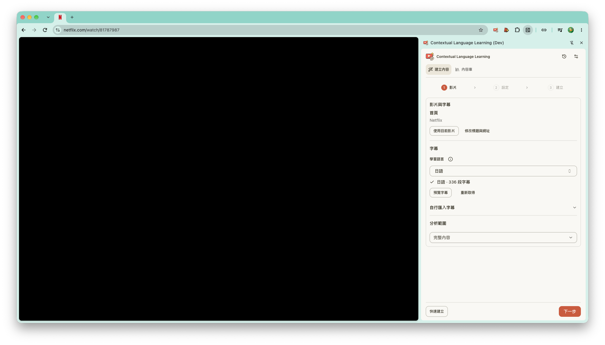

# Contextual Language Learning

[English](README.md) | [繁體中文](README.zh-TW.md) | [简体中文](README.zh-CN.md) | **日本語** | [한국어](README.ko.md)

動画の字幕から AI で語学教材を作り、元の動画で練習できるツールです。

## できること

- 解説、翻訳、読み方、例文を含む教材を作成できます。
- 自分で指示を書いて、要約や単語リストなどの学習ノートを作れます。
- 対応する動画の場面や文を繰り返し再生し、再生速度を調整できます。
- 教材をパソコンに保存し、JSON／Markdown で書き出せます。Google Drive へのバックアップも選べます。
- 対応する AI アカウントや API キーを接続するか、互換性のあるローカルモデルを使えます。

## 使い始めるには

拡張機能は **macOS、Windows、Linux** の **Chrome、Edge、Chromium** に対応しています。

**開発プレビュー版：**すぐに使えるインストールパッケージは、まだ公開されていません。

1. [ソースコードからのインストール手順（英語）](docs/development.md#install-from-source)に従い、拡張機能とローカルサービスをインストールします。
2. 「**設定 → AI サービス**」でアカウントを接続するか API キーを入力し、モデルを選びます。
3. YouTube または Netflix の動画を開いて利用可能な字幕を取得するか、SRT、VTT、TXT ファイルを読み込みます。
4. 学習する言語とレベルを選んで教材を作成し、「**ライブラリ**」から開いて学習・練習します。

## 利用前に知っておくこと

- AI による生成では、選んだ字幕が指定したサービスに送信されます。そのサービスの利用上限や料金が適用されます。
- Netflix 連携と Google Drive バックアップは実験的な機能です。Drive には [OAuth 設定（英語）](docs/development.md#optional-google-drive-backup)が必要です。字幕を自動取得できない場合は、ファイルを読み込んでください。
- 処理する権限のある字幕のみを使用してください。

## 詳しい情報

[開発ガイド（英語）](docs/development.md) · [貢献方法](CONTRIBUTING.md) · [プライバシー](PRIVACY.md) · [セキュリティ](SECURITY.md)

[MIT ライセンス](LICENSE)で公開されています。
