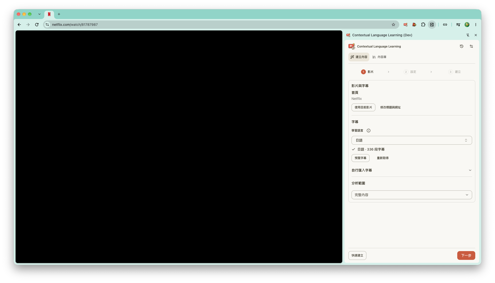

# Contextual Language Learning

[English](README.md) | [繁體中文](README.zh-TW.md) | [简体中文](README.zh-CN.md) | [日本語](README.ja.md) | **한국어**

영상 자막을 AI 학습 자료로 만들고, 원본 영상을 보며 연습하세요.

## 주요 기능

- 설명, 번역, 발음 안내와 예문이 포함된 학습 자료를 만듭니다.
- 직접 작성한 프롬프트로 요약, 단어장 등 학습 노트를 만듭니다.
- 지원되는 영상에서 장면이나 문장을 반복 재생하고 재생 속도를 조절합니다.
- 학습 자료를 컴퓨터에 저장하고 JSON／Markdown으로 내보냅니다. Google Drive 백업도 선택할 수 있습니다.
- 지원되는 AI 계정이나 API 키를 연결하거나, 호환되는 로컬 모델을 사용할 수 있습니다.

## 시작하기

확장 프로그램은 **macOS, Windows, Linux**의 **Chrome, Edge, Chromium**에서 사용할 수 있습니다.

**개발 미리 보기 버전:** 바로 사용할 수 있는 설치 패키지는 아직 공개되지 않았습니다.

1. [소스 설치 안내(영어)](docs/development.md#install-from-source)에 따라 확장 프로그램과 로컬 서비스를 설치합니다.
2. **설정 → AI 서비스**에서 계정을 연결하거나 API 키를 입력하고 모델을 선택합니다.
3. YouTube 또는 Netflix 영상을 열어 이용 가능한 자막을 가져오거나, SRT, VTT, TXT 파일을 불러옵니다.
4. 학습할 언어와 수준을 선택해 자료를 만든 뒤, **라이브러리**에서 열어 학습하고 연습합니다.

## 사용 전 참고 사항

- AI 생성 시 선택한 자막이 지정한 서비스로 전송됩니다. 해당 서비스의 이용 한도와 요금이 적용됩니다.
- Netflix 연동과 Google Drive 백업은 실험 기능입니다. Drive는 [OAuth 설정(영어)](docs/development.md#optional-google-drive-backup)이 필요합니다. 자막을 자동으로 가져올 수 없다면 파일을 불러오세요.
- 처리할 권한이 있는 자막만 사용하세요.

## 더 알아보기

[개발 가이드(영어)](docs/development.md) · [기여 방법](CONTRIBUTING.md) · [개인정보 안내](PRIVACY.md) · [보안 정책](SECURITY.md)

[MIT 라이선스](LICENSE)로 공개되어 있습니다.
