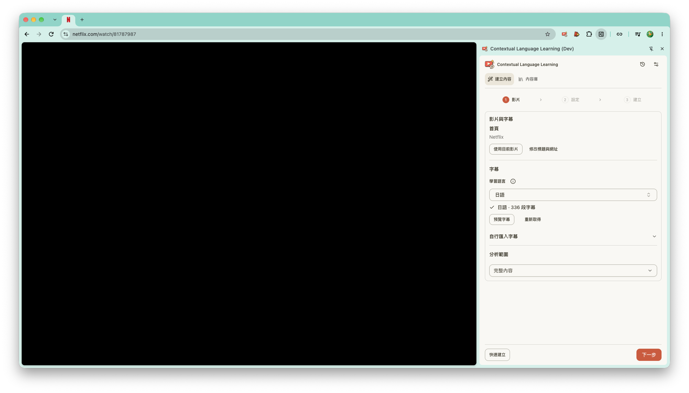

# Contextual Language Learning

**English** | [繁體中文](README.zh-TW.md) | [简体中文](README.zh-CN.md) | [日本語](README.ja.md) | [한국어](README.ko.md)

Turn video subtitles into AI language lessons, then practise with the original video.

## What you can do

- Create lessons with explanations, translations, pronunciation notes and examples.
- Use your own prompts for summaries, vocabulary lists and other study notes.
- Replay scenes or sentences and adjust playback speed on supported videos.
- Keep lessons on your computer, export JSON/Markdown and optionally back up to Google Drive.
- Connect a supported AI account or API key, or use a compatible local model.

## Get started

The extension runs in **Chrome, Edge and Chromium** on **macOS, Windows and Linux**.

**Development preview:** ready-to-use installers have not been published yet.

1. Follow the [source setup guide](docs/development.md#install-from-source) to install the extension and its local service.
2. Open **Settings → AI services**, connect your account or API key, and choose a model.
3. Open a YouTube or Netflix video and retrieve its available subtitles, or import an SRT, VTT or TXT file.
4. Choose your learning language and level, create the lesson, then open it in **Library** to study and practise.

## Good to know

- AI generation sends the selected subtitles to your chosen service. Its usage limits and fees apply.
- Netflix integration and Google Drive backup are experimental. Drive needs [OAuth setup](docs/development.md#optional-google-drive-backup); import a subtitle file if automatic retrieval is unavailable.
- Only use subtitles you have permission to process.

## More information

[Development guide](docs/development.md) · [Contributing](CONTRIBUTING.md) · [Privacy](PRIVACY.md) · [Security](SECURITY.md)

Open source under the [MIT license](LICENSE).
