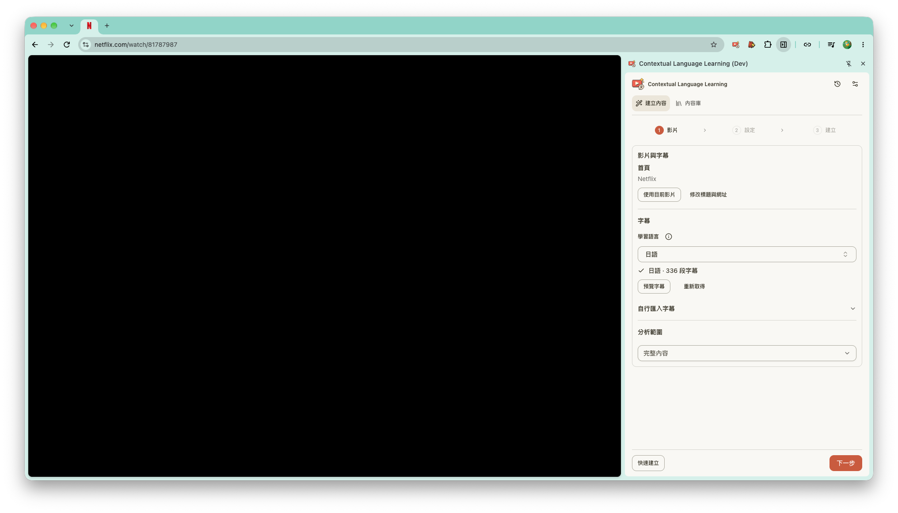

# Contextual Language Learning

[English](README.md) | [繁體中文](README.zh-TW.md) | **简体中文** | [日本語](README.ja.md) | [한국어](README.ko.md)

把视频字幕变成 AI 语言教材，再配合原视频练习。

## 可以做什么

- 创建包含讲解、翻译、读音和例句的教材。
- 用自己的指令生成摘要、单词表等学习笔记。
- 在支持的视频中重复播放场景或句子，并调整播放速度。
- 将教材保存在电脑上，导出 JSON／Markdown，也可选择备份到 Google Drive。
- 连接支持的 AI 账号或 API 密钥，或使用兼容的本地模型。

## 开始使用

扩展支持 **macOS、Windows、Linux** 上的 **Chrome、Edge、Chromium**。

**开发预览版：**目前尚未提供可直接使用的安装包。

1. 按照[源码安装指南（英文）](docs/development.md#install-from-source)，安装扩展和本地服务。
2. 打开「**设置 → AI 服务**」，连接账号或输入 API 密钥，再选择模型。
3. 打开 YouTube 或 Netflix 视频，获取可用字幕，或导入 SRT、VTT、TXT 文件。
4. 选择学习语言和水平，创建教材，再到「**内容库**」打开教材阅读和练习。

## 使用前须知

- AI 生成会将选中的字幕发送给你选择的服务，使用额度和费用以该服务的规定为准。
- Netflix 集成和 Google Drive 备份仍属实验功能。Drive 需要[配置 OAuth（英文）](docs/development.md#optional-google-drive-backup)；无法自动获取字幕时，可改用文件导入。
- 请只使用你有权处理的字幕。

## 更多信息

[开发指南（英文）](docs/development.md) · [参与贡献](CONTRIBUTING.md) · [隐私说明](PRIVACY.md) · [安全政策](SECURITY.md)

本项目以 [MIT 许可证](LICENSE)开放源代码。
