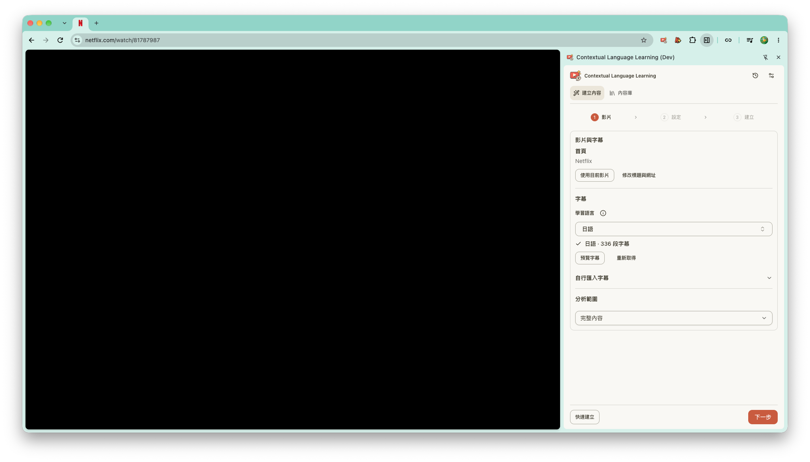

# Contextual Language Learning

[English](README.md) | **繁體中文** | [简体中文](README.zh-CN.md) | [日本語](README.ja.md) | [한국어](README.ko.md)

把影片字幕變成 AI 語言教材，再搭配原始影片練習。

## 可以做什麼

- 建立包含解說、翻譯、讀音與例句的教材。
- 用自己的指令產生摘要、單字表等學習筆記。
- 在支援的影片中重播場景或句子，並調整播放速度。
- 將教材保存在電腦，匯出 JSON／Markdown，也可選擇備份到 Google Drive。
- 連接支援的 AI 帳號或 API 金鑰，或使用相容的本機模型。

## 開始使用

擴充功能支援 **macOS、Windows、Linux** 上的 **Chrome、Edge、Chromium**。

**開發預覽版：**目前尚未提供可直接使用的安裝包。

1. 依照[原始碼安裝指南（英文）](docs/development.md#install-from-source)，安裝擴充功能與本機服務。
2. 開啟「**設定 → AI 服務**」，連接帳號或輸入 API 金鑰，再選擇模型。
3. 開啟 YouTube 或 Netflix 影片，取得可用字幕，或匯入 SRT、VTT、TXT 檔案。
4. 選擇學習語言與程度，建立教材，再到「**內容庫**」開啟教材閱讀與練習。

## 使用前須知

- AI 生成會將選取的字幕傳送給你選擇的服務，使用額度與費用依該服務規定。
- Netflix 整合與 Google Drive 備份仍屬實驗功能。Drive 需要[設定 OAuth（英文）](docs/development.md#optional-google-drive-backup)；無法自動取得字幕時，可改用檔案匯入。
- 請只使用你有權處理的字幕。

## 更多資訊

[開發指南（英文）](docs/development.md) · [參與貢獻](CONTRIBUTING.md) · [隱私說明](PRIVACY.md) · [安全政策](SECURITY.md)

本專案以 [MIT 授權](LICENSE)開放原始碼。
