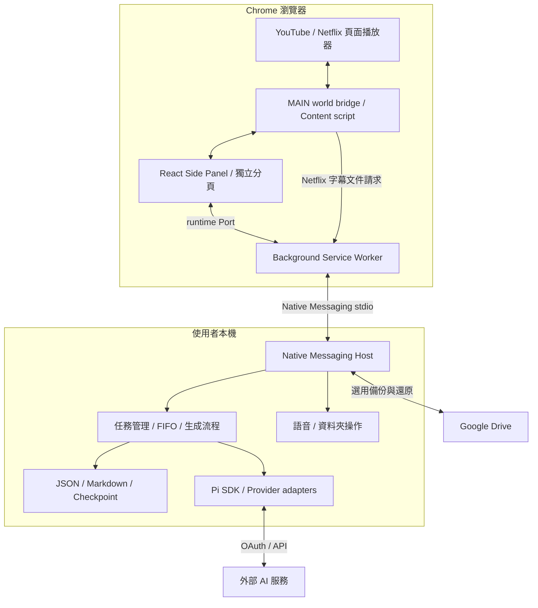

# Contextual Language Learning 整體架構

本文件依 2026-10-17 的開發工作目錄整理。專案採 pnpm monorepo：Chrome 擴充功能提供學習介面與影片整合，本機 Native Messaging Host 負責 AI、教材檔案與系統功能，`@contextual/core` 定義兩端共用的資料契約與驗證。

這是原始碼架構說明，不代表已安裝的擴充功能、Host、外部帳號或正式發行版本已通過驗收。README 與實作紀錄可能包含歷史描述；目前流程以本文件連結的程式入口與版本常數為準。

## 1. 系統全貌



`packages/core` 是由兩端引用的共用程式庫，沒有獨立程序。Setup 是安裝／更新工具；一般使用時的 Host 由瀏覽器透過 Native Messaging 啟動，沒有獨立常駐 daemon。

| 邊界     | 主要責任                                          | 程式入口                                                                                                                                    |
| -------- | ------------------------------------------------- | ------------------------------------------------------------------------------------------------------------------------------------------- |
| 學習介面 | 建立內容、素材庫、Reader、Activity、設定          | [`App.tsx`](../apps/extension/src/App.tsx)                                                                                                  |
| 背景連線 | Host 連線、請求／進度轉送、通知、斷線恢復         | [`background.ts`](../apps/extension/src/background.ts)、[`generation-controller.ts`](../apps/extension/src/native/generation-controller.ts) |
| 影片整合 | 平台辨識、字幕、播放狀態、跳轉、循環、倍速        | [`video/`](../apps/extension/src/video/)、[`content/`](../apps/extension/src/content/)                                                      |
| 本機服務 | 協定分派、任務生命週期、AI、檔案、備份、語音      | [`local-host/src/index.ts`](../apps/local-host/src/index.ts)                                                                                |
| 共用核心 | Zod schema、來源驗證、任務契約、Reader 投影、匯出 | [`core/src/index.ts`](../packages/core/src/index.ts)                                                                                        |

## 2. 目錄與依賴方向

```text
apps/extension/src/
  App.tsx          應用組裝、畫面切換、跨功能狀態與事件
  components/      Create、Library、Reader、設定與共用 UI
  hooks/           React 與字幕、草稿、登入、影片狀態的接合
  lib/             草稿、偏好、請求組裝與內容目錄等邏輯
  native/          Host client、背景連線控制、文件分塊重組
  video/           平台 adapter、來源、播放時間與循環邏輯
  content/         隔離世界與頁面 MAIN world 橋接
  i18n/            介面文案與相關驗證
apps/local-host/src/
  index.ts         stdio framing、程序生命週期與依賴組裝
  host/            dispatcher 與業務 handler
  jobs/            標準／自訂任務、排隊、取消與執行擁有權
  generation/      標準／自訂流程、提示詞、語言策略與容量預算
  agents/          Pi runtime、模型、認證、provider、安全重試
  storage/         repository、發布、備份、逐文件同步
  drive/           Google OAuth、憑證與 Drive API
  platform/        OS 路徑、語音、資料夾、品牌資料搬移
apps/local-host/setup/   安裝／更新／移除本機服務的介面
packages/core/src/       共用契約、來源／教學驗證、展示轉換
scripts/                 安裝、檢查與發行包裝
```

Extension 與 Host 都依賴 core，兩個 app 之間以訊息契約溝通。Host 的 `storage/ports.ts` 定義 repository 介面；`index.ts` 注入檔案實作、JobManager 與回覆函式。`host/dispatcher.ts` 驗證輸入後交給 generation、custom、lessons、publication、agents、drive、speech 等 handler。

`App.tsx` 保留應用導航、全域偏好與跨頁事件。Create 的草稿恢復、步驟、分析範圍、本次設定覆寫、預估及送出條件由 [`use-create-flow.ts`](../apps/extension/src/hooks/use-create-flow.ts) 管理；[`create-frame.tsx`](../apps/extension/src/components/create-frame.tsx) 管理其導覽、捲動與 Footer。來源、內容設定及確認的 JSX 仍由 App 組裝。`GenerationSession` 的生命週期維持由 App 擁有，不隨 Create 導覽結束。

語言／外觀設定由受控的 `AppearancePreferences` 呈現，保存仍交由全域 preferences store。`connectDriveAndVerify` 封裝 OAuth 身分確認與 Drive 權限驗證順序；App 在身分確認後更新帳號列表，在權限驗證成功後才標記可用並啟用備份。

自訂 Markdown、字幕編輯與進階設定透過 `deferView` 按需載入，`DeferredView` 提供局部讀取／錯誤介面；草稿與生成 session 留在 App。內容庫與標準 Reader 維持同步載入以保留首次導航速度，量測方法與取捨見[載入效能紀錄](./load-performance.md)。

介面以 Create／Library 為主導航，Reader 與 Custom Viewer 是內容詳細頁，Settings／Activity 由 Header actions 開啟。Create 分成來源、內容設定、確認三步，標準教材與自訂 Markdown 在內容設定中切換。字幕草稿、provider 登入及影片連線分別由 hooks 接入 React；全域偏好與每份教材的學習位置分開保存。

## 3. 標準教材的端到端資料流

1. **建立來源。** 匯入 SRT／VTT／文字，或由影片 adapter 取得字幕。保留 cue ID、原文與時間；有時間來源支援完整、前半、後半、自訂分析範圍，無時間來源僅允許完整內容。
2. **固定請求。** 組裝語言、程度、解說、場景數、provider／model、資料夾及備份設定。重複檢查與送出使用固定輸入；Host 的短效 ticket 綁定該請求，開始前再次檢查重複。
3. **持久化入列。** Background 轉送請求；Host 先保存 snapshot 再回覆已受理。標準與自訂生成共用 FIFO。
4. **分析候選。** 固定模型執行身份，依容量建立字幕窗口，找出候選場景與完整語句。同一任務最多並行兩個候選窗口，遇 429 後降低為單工。
5. **挑選與固定單位。** 選定場景、教學單位及來源範圍；必要時階層挑選。共用字幕的連通單位群組不可拆到不同教學批次。
6. **生成與程式驗證。** 逐批生成翻譯、句意、語塊、重點及例句；驗證結構、來源、引用、覆蓋與重複。一般結構失敗最多追加一次修正生成。容量不足另有拆批或不可拆群組擴充輸出預算的處理，仍受固定模型容量限制。
7. **保存與交付。** 整份驗證後保存 canonical JSON／Markdown，再執行選用資料夾副本與 Drive 備份。Background 轉送進度及完成通知；Reader 讀取教材並接回來源影片。

```text
App / generation-session
  → host-client → background generation-controller
  → Native Host dispatcher → host/generation
  → GenerationQueue → JobManager
  → runGenerationPipeline → runLearningPointsPipeline
  → Pi SDK / 共用驗證 / File repositories
  → publication / optional backup → Reader
```

目前 [`generation/pipeline.ts`](../apps/local-host/src/generation/pipeline.ts) 唯一轉入 [`learning-points-pipeline.ts`](../apps/local-host/src/generation/learning-points-pipeline.ts)。 後者依序呼叫 `learning-candidates.ts`、`learning-selection.ts`、`learning-teaching.ts`，透過 `learning-execution.ts` 共用固定模型、用量記錄及序列化 checkpoint 寫入；`generation/legacy/` 保留歷史品質審查工具，當前流程不引用它們。舊 `scene-pipeline.ts` 已不在目前工作目錄。prompts-14 使用完整教學生成與程式驗證，沒有固定的 AI 品質審查／修補／複查三段模型流程；不可靠的選填讀音由本地處理省略。

## 4. 教材資料與閱讀模型

| 資料                         | 用途                                                     |
| ---------------------------- | -------------------------------------------------------- |
| `cues`                       | 原始字幕 ID、文字與時間，是來源依據                      |
| `sections`                   | 選中場景的字幕、翻譯及教學單位                           |
| `utterances` / `sourceSpans` | 教學單位，以 cue ID 與 UTF-16 起訖位置指向原文，可跨字幕 |
| `points`                     | 與教學單位關聯的學習重點                                 |
| `reusableItems`              | 可重用表達／句型、來源形式及 AI 例句                     |
| `execution`                  | workflow、prompt、策略、模型、容量及可取得的呼叫用量     |
| playback overrides           | 使用者校正的播放範圍，與原始字幕時間分開保存             |

教學單位必須依序、完整且不重疊地覆蓋所選場景來源，包括空白與標點，不能切開 Unicode 字素群。完整來源覆蓋不表示每句都需要額外重點或解說。

[`reader-model.ts`](../packages/core/src/reader-model.ts) 的 `readerScene()`／`readerPresentation()` 產生展示投影，處理跨字幕關聯、空解說及重複內容。`contextual-scene-reader.tsx`／`sentence-dialogue.tsx` 呈現來源、解析與例句；來源字幕每條只顯示一次，必要時切換同一來源的不同教學單位。

文字與播放各有依據：`sourceSpans` 對照原文；播放採原字幕時間及校正範圍，不從字元位置推算音訊切點。系統朗讀讀取選定教材文字，與影片循環播放分開。

## 5. 任務、並行與恢復

| 範圍                  | 目前行為                                                              |
| --------------------- | --------------------------------------------------------------------- |
| 任務排隊              | 同一 Host 的標準／自訂任務共用 FIFO，依序執行                         |
| 任務內並行            | 候選分析最多兩個；教學批次依序執行                                    |
| 入列與執行            | 分開序列化，前一任務執行時可保存後續任務                              |
| 關閉側欄              | 移除訂閱；活躍生成由 Background 保持 Host 連線                        |
| 側欄結束朗讀          | 停止該側欄擁有的語音，不取消生成                                      |
| 瀏覽器退出／Host 中斷 | 停止執行並保留 checkpoint，沒有 daemon 接手                           |
| 重新開啟              | 列表依 owner PID 辨識失去執行者的任務，標記 waiting，由使用者要求續跑 |
| 背景斷線重連          | 最多依 1／2／4 秒重試，只握手與查詢狀態，不重送生成等副作用請求       |

Checkpoint 保存候選、選材、完成批次、模型身份、修正狀態與用量。有效教學已收到但取消發生在完成提交前時，以 `pendingTeaching` 保存。續跑核對來源、版本與模型，重用已完成部分。特定 prompts-12／13 舊 V7 任務可在續跑時升級並記錄 `previousExecution`，不代表任意舊任務皆可恢復。

[`agents/safe-retry.ts`](../apps/local-host/src/agents/safe-retry.ts) 僅對可辨識的安全拒絕最多追加兩次傳輸重試。未知是否已計費的失敗、空最終回覆不自動重送。程式驗證檢查資料一致性，不能單獨證明翻譯或語言教學品質。

## 6. 自訂 Markdown 流程

自訂內容使用 [`custom.ts`](../packages/core/src/custom.ts) 的 `custom-v1`、CustomJobManager、[`custom-pipeline.ts`](../apps/local-host/src/generation/custom-pipeline.ts) 及獨立 repository，不經標準教材的教學單位流程。

依保守 UTF-8 byte 預算規劃 segment／merge 節點，分段生成 Markdown 再階層整合，每個節點保存結果。輸入 fingerprint、workflow／prompt／schema 及模型固定；不相容時拒絕續跑。最終輸出已取得但存檔失敗時，可重試保存而不重新生成。

Viewer 阻擋 raw HTML、可執行連結與遠端圖片。重新生成建立新文件 ID 並連回前一版本。刪除文件、清除歷史、刪除遠端備份與已匯出副本是不同操作。自訂備份以 Markdown 及 checksum 關聯 metadata 交付，支援部分上傳重試與還原驗證。

## 7. 儲存與同步

| 資料               | 保存位置／責任                                                                                |
| ------------------ | --------------------------------------------------------------------------------------------- |
| 介面與生成偏好     | `chrome.storage.local` 的 `preferencesV2`，由 store 驗證、訂閱並排序寫入                      |
| 大型來源／建立草稿 | IndexedDB `cll-drafts`；不含憑證，字幕草稿管理影片／語言及過期回覆                            |
| 學習位置           | 瀏覽器的 `contextualStudyV5:<documentId>`；保留的名稱不代表教材版本                           |
| 標準教材／任務     | `~/Documents/Contextual Language Learning/data-v7/`，含影片資料夾、`jobs/`、`lesson-records/` |
| 自訂內容           | `~/Documents/Contextual Language Learning/custom-v1/`，含 `metadata.json`／`content.md`       |
| AI 憑證            | OS 對應 app config root 下的 `pi/auth.json`，與其他 CLI 認證分開                              |
| Google 憑證        | `drive/oauth.ts`／`keychain-credentials.ts` 管理，與 AI 憑證分開                              |
| 選用副本           | 使用者核准資料夾中的 JSON／Markdown                                                           |
| 選用遠端備份       | Google Drive，由 Host 管理帳號、修訂、checksum、上傳及還原                                    |

列表列舉影片資料夾時會一併保留檔案路徑，直接讀取與驗證教材，避免每份文件再次搜尋全部資料夾。排序、上限及重複 ID／損壞檔案的錯誤保持一致；目前仍讀取完整教材，尚未建立持久摘要索引。

本機 canonical 文件是教材依據。File repository 使用 UUID 路徑及暫存檔 rename；首次保存標準教材時先寫 Markdown，最後提交 canonical JSON。這不是跨多檔或跨程序的資料庫交易。

[`document-sync.ts`](../apps/local-host/src/storage/document-sync.ts) 依同一 repository 的文件 ID 序列化校正、發布、備份、還原及歷史清除等完整操作；不同文件可各自進行。校正先保存本機，遠端失敗回報警告，不回滾教材。發布 journal 記錄可替換檔案雜湊，獨立編輯的副本視為衝突；備份狀態包含 revision 與 account，舊上傳不能代表新修訂已同步。

保證限於共享 Host／repository 的程序內邊界，不提供不同瀏覽器 Host 之間的全域交易鎖。清除標準任務歷史可保留教材及發布／備份所需的精簡紀錄。

## 8. 外部整合與安全邊界

**影片平台。** [`VideoAdapter`](../apps/extension/src/video/types.ts) 用可選方法宣告字幕、狀態、seek、loop、倍速及 timestamp link 等能力，YouTube／Netflix 各自實作；匯入來源仍可閱讀。Content script 與 MAIN world bridge 接通頁面播放器。新增平台還需個別檢查 manifest 權限，註冊 adapter 本身不授予網站存取權。Netflix 字幕文件由 worker 驗證 sender／watch ID 後從 allowlist 網域抓取；內部播放器 API 仍屬實驗整合。

**AI provider。** core 的 `pi-providers.ts` 是共享 registry，Host 的 `provider-registry.ts` 設定 adapter。當前固定 Pi SDK **1.0.4**、`pi-antigravity` **0.10.0**，相容 patch 隨 lockfile 納入建置。ModelRuntime 依產品認證目錄共用；每次呼叫建立獨立記憶體 Session，禁用 tools 及全域／專案 skills、prompts、AGENTS、extensions 探索。登入輸入只暫存並轉交 Host，登入 UI 以 operation／prompt ID 拒絕過期事件。

模型清單採 SDK authentication／provider filter 及適用的動態 catalog；`getAvailable()` 不普遍等於帳號 entitlement、剩餘額度或生成成功保證。初始輸入估算不執行 inference；API 參考價格不等於實際帳單，未知用量保持未知。斷開 AI 服務刪除產品憑證，不等於在 provider 撤銷授權。

Antigravity 只接入 OAuth、聊天模型與 transport，不載入上游工具／帳號管理擴充。額外帳號查找限制在產品的 `pi/antigravity/`，以非同步目錄作用域隔離；更新套件需重新檢查 patch、型別與 standalone bundle。

**OS 能力。** `host/speech.ts` 經 `platform/speech.ts` 接 macOS 語音 helper／Siri 與 Windows Narrator；目前 Linux 不提供系統朗讀。語音不占用生成 FIFO。資料夾選擇、開啟及系統路徑由 Host 平台層處理。

## 9. 版本、安裝與開發

| 契約                 | 目前值                                                                                  | 定義                                        |
| -------------------- | --------------------------------------------------------------------------------------- | ------------------------------------------- |
| 標準教材             | schema `7`                                                                              | `packages/core/src/schema.ts`               |
| 標準任務 snapshot    | schema `5`                                                                              | `packages/core/src/jobs.ts`                 |
| 精簡任務紀錄         | schema `1`                                                                              | `apps/local-host/src/storage/ports.ts`      |
| Workflow／prompt     | `learning-points-v7-1`／`learning-points-prompts-14`                                    | core `schema.ts`                            |
| 語言／程度／驗證策略 | `learning-language-strategies-4`／`learning-level-strategies-1`／`program-validation-1` | core `schema.ts`                            |
| 自訂內容             | `custom-v1`，`custom-markdown-1`／`custom-prompt-1`                                     | core `custom.ts`／Host `custom-pipeline.ts` |
| Native Messaging     | protocol `12`                                                                           | core `native-messaging.ts`                  |
| Native Host 名稱     | `dev.contextual.language_learning`                                                      | Extension controller／安裝腳本              |

業務連線須先通過 package version、protocol 及 `pi-sdk` mode 握手。設定健康檢查另開一次性 Native 連線，驗證當下註冊及啟動器，避免舊 port 掩蓋更新／移除結果；不相容時保留版本資訊供 UI 顯示，阻擋業務請求。

目前標準教材以 V7 為範圍，可讀的 prompts-12／13 V7 是明確相容例外。舊 `data-v5/`、`data-v6/` 保留於原位置，沒有自動轉換或合併進素材庫。品牌搬移是獨立操作：Host 首次啟動先複製舊名稱的設定／文件，保留原件，以 marker 防重複，遇衝突停止；不會升級教材 schema。

開發以 `pnpm dev` 啟動 CRXJS HMR，`127.0.0.1:5174` 使用 `dist-dev`；production 以 Vite 加 content-script build 產出 `apps/extension/dist`。MAIN world 的 `document_start` bridge 改動須重新載入影片頁面。Host 用 esbuild 打包 SDK 與平台 helper 到 `apps/local-host/dist`，修改後還須安裝到對應瀏覽器／extension ID。

`scripts/package-host-setup.mjs` 組裝含 Node runtime 與安裝 UI 的 Setup；`scripts/package-release.mjs` 包裝 Chromium ZIP、三個 OS 的 arm64／x64 Setup ZIP 及 SHA256SUMS。解除安裝移除所選瀏覽器註冊，保留教材、歷史與設定。建置、安裝、瀏覽器實測與商店發布各自是不同交付步驟。

## 10. 查碼與驗證入口

| 要理解的行為         | 優先閱讀                                                                                         |
| -------------------- | ------------------------------------------------------------------------------------------------ |
| 固定請求與重複檢查   | Extension `lib/generation-request.ts`、`native/generation-session.ts`；Host `host/generation.ts` |
| 連線、進度、取消     | Extension `native/generation-controller.ts`；Host `jobs/running-operation.ts`                    |
| 候選、挑選、教學     | Host `generation/learning-points-pipeline.ts`、`learning-points-prompts.ts`                      |
| 來源與資料一致性     | core `source-units.ts`、`learning-points.ts`、`schema.ts`、`jobs.ts`                             |
| 閱讀與影片循環       | core `reader-model.ts`；Extension `video/reader-playback.ts`、`loop-window.ts`                   |
| 發布、校正與備份     | Host `storage/document-sync.ts`、`publish.ts`、`backup.ts`、`document-queue.ts`                  |
| Provider／登入／模型 | core `pi-providers.ts`；Host `agents/pi.ts`；Extension `lib/pi-auth-state.ts`                    |

一般檢查為 `pnpm format:check`、`pnpm typecheck`、`pnpm test`、`pnpm build`，另有各層定向與 acceptance 腳本。這些指令列在此不代表本次已執行或全數通過；文件修改可只檢查格式與連結。實際模型、安裝後 Host、Chrome 擴充功能、真實影片、Drive 帳號需分別提供驗收證據。更多內容見 [TESTING.md](./TESTING.md)、[Host Setup](./host-setup.md) 與 [prompts-14 簡化生成紀錄](./simple-generation-implementation.md)。

本次模組拆分、效能樣本及驗證限制見 [架構重構紀錄](./architecture-refactor.md)。
